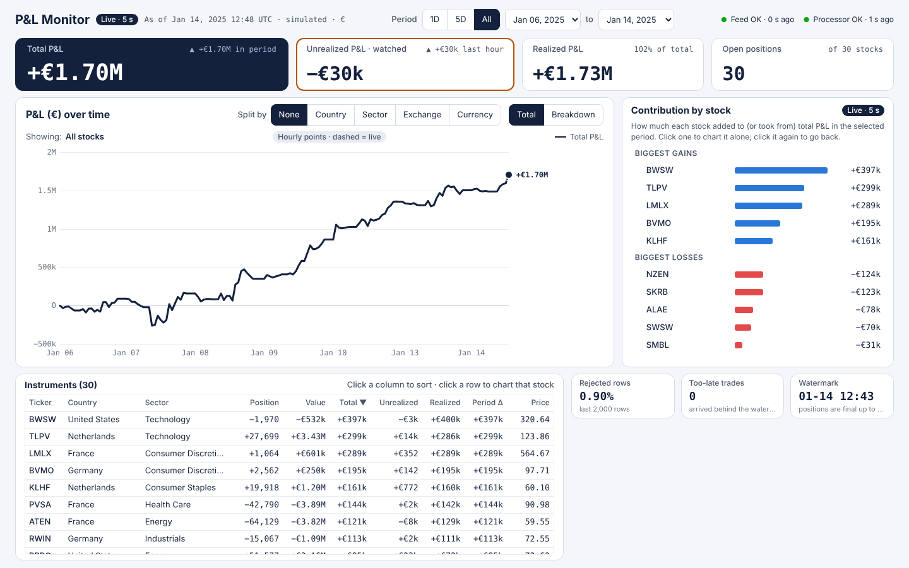
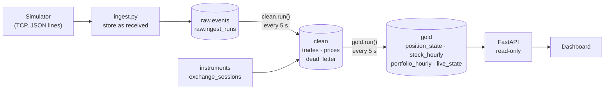
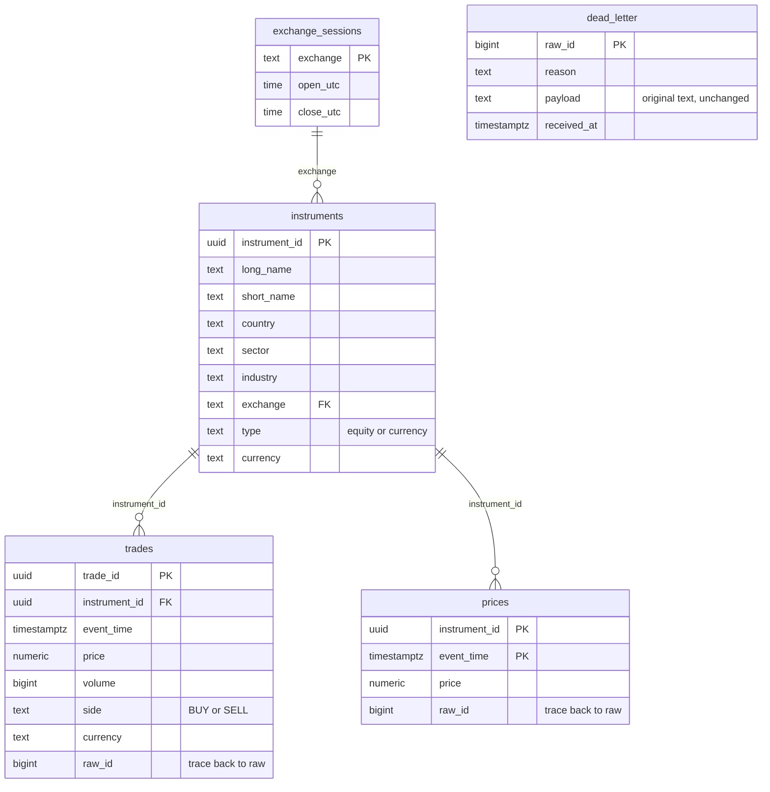

# market-sim · Intraday P&L Monitor for a Market-Making Desk

A streaming data pipeline and dashboard that turn a raw, messy feed of trades and quotes into a
trusted, drill-down **profit-and-loss view in euros**, in near real time.

**Stack:** Python · PostgreSQL (PL/pgSQL) · FastAPI · static HTML dashboard · pytest
**Pattern:** raw → clean → gold (bronze / silver / gold), incremental processing, event-time watermark

> Everything here is **simulated**. Companies, tickers and prices are fictional and generated by a random
> process. This is a portfolio project, not a trading system.



---

## 1. The problem

Picture a market-making desk in Europe. It trades 30 stocks on six exchanges: Amsterdam, Frankfurt and Paris
(euro), London (pound), New York (dollar) and Tokyo (yen). It is long some names and short others. The people around
it keep asking the same questions:

- *Traders:* what is the whole book making or losing **right now**, and how much of it is unrealized?
- *Risk and middle office:* **where** is the money coming from, by country, sector, exchange or currency, and by stock?
- *Finance:* can I trust the number, given that the feed is imperfect?

The input is a continuous TCP stream, and it is not clean. Some lines are garbled, some messages are
duplicated, some arrive late and out of order, and prices come in several currencies with no direct quote to
the euro. The job of this project is to turn that stream into numbers people can rely on, and to say clearly
what was rejected, what arrived too late, and what was assumed.

**What the dashboard is for.** To compute, correctly, the P&L of a portfolio that includes foreign-currency
stocks, reported in one currency (EUR), and to give a simple attribution of where it comes from: by country,
sector, exchange, currency and stock.

**A 5-minute delay, by design.** Trades can arrive late and out of order, and a late trade does more than
leave a hole in a total. It changes the **average cost**, and every realized and unrealized figure computed
from that cost afterwards, so one late trade can make the P&L of a whole stock wrong for good.

The fix is an event-time **watermark** (section 8): a trade is applied only once it is 5 minutes older than the
latest event time seen, and always in event-time order. The price of correctness is that positions and realized
P&L trail the market by up to 5 minutes. Prices and FX rates are always the latest.

**What makes it a real data-engineering problem**

| Dimension | What has to be handled |
|---|---|
| Multi-currency | EUR, USD, GBP, JPY; everything is reported in EUR. GBP and JPY have no direct EUR quote, so a chain of FX quotes is needed |
| Multi-market, multi-timezone | Six exchanges with different opening hours, no trading at weekends, FX quoted around the clock |
| Long and short | Positions can go negative, and a single trade can close a position and open the opposite one |
| Event time vs processing time | A message can be stamped earlier than ones already processed; results must still be right |
| Dirty data | About 1% of rows are corrupt, and duplicates and conflicting quotes appear |
| Reference data | Two dimension tables (instruments, exchange sessions) give meaning to the stream |

---

## 2. How the P&L is calculated

This is the heart of the project, so it comes before the plumbing. Each stock gets three numbers, which are
then converted to euros and added up.

### Definitions

```
Realized P&L   = Σ over closing trades of (trade price − average cost) × closed quantity × sign(position before)
Unrealized P&L = (mark price − average cost) × net position
Total P&L      = Realized P&L + Unrealized P&L
```

- **Average cost** is the average entry price of the open position, weighted by quantity. For a long position it is
  the average price of the buys that built it. For a short position it is the average price of the sells that built
  it. Adding to a position moves it, reducing a position leaves it unchanged, and a trade that flips the position
  through zero resets it to the trade price for the part that opens the new position. This is the average-cost
  method (not FIFO).
- **Net position** is signed: buys are positive, sells negative. A long position gains when the price rises, a
  short position gains when it falls. One formula covers both because the sign sits in the position
  (`sign(position before)` is +1 when a sale closes a long and −1 when a purchase covers a short).
- **Mark price** is the latest quote for the stock. The feed carries one price per quote, with no bid and ask.
- **Realized** is locked in by closing trades. **Unrealized** is what closing the whole position at the mark
  price would earn right now. It moves whenever the market moves, with or without a trade.

### One stock, trade by trade

The table follows one stock in its local currency. Trades change the position, the average cost and the
realized P&L. Quotes change the market price and therefore the unrealized P&L. To keep the example simple,
each trade is assumed to be made at the prevailing market price.

| # | Event | Trade price | Market price | Position | Avg cost | Realized (this trade) | Realized (cumulative) | Unrealized | Total |
|---|---|---|---|---|---|---|---|---|---|
| 1 | Buy 100 | 10 | 10 | 100 | 10 | 0 | 0 | 0 | 0 |
| 2 | Buy 100 | 12 | 12 | 200 | 11 | 0 | 0 | +200 | +200 |
| 3 | Quote only | – | 14 | 200 | 11 | 0 | 0 | +600 | +600 |
| 4 | Sell 50 | 13 | 13 | 150 | 11 | +100 | +100 | +300 | +400 |
| 5 | Sell 250 | 12 | 12 | −100 | 12 | +150 | +250 | 0 | +250 |
| 6 | Quote only | – | 11 | −100 | 12 | 0 | +250 | +100 | +350 |
| 7 | Quote only | – | 13 | −100 | 12 | 0 | +250 | −100 | +150 |

Reading it row by row:

- **Row 2.** Average cost = (100 × 10 + 100 × 12) / 200 = 11. Unrealized = (12 − 11) × 200 = **+200**. Seen
  another way, the first 100 shares are up 2 each and the second 100 are up 0. Nothing was sold, yet there is
  already unrealized profit, because the market price is above the cost.
- **Row 3.** No trade at all, only a new quote (12 → 14). Position and cost are unchanged, and unrealized moves
  from +200 to (14 − 11) × 200 = **+600**.
- **Row 4.** Selling does not change the average cost. Realized = (13 − 11) × 50 = **+100**. The 150 shares left
  are valued at (13 − 11) × 150 = +300.
- **Row 5.** The trade crosses zero. It closes the 150 long shares for (12 − 11) × 150 = **+150**
  (cumulative +250), and the other 100 shares open a short at 12, so the average cost resets to 12.
- **Rows 6 and 7.** The same formula works for the short. The price falls to 11: (11 − 12) × (−100) = **+100**.
  It rises to 13: (13 − 12) × (−100) = **−100**.

**These are real gains and losses.** For the short: 100 shares were sold at 12 (1,200 received), and buying them
back at 11 costs 1,100, a profit of 100, which is row 6. For the long in row 3: closing 200 shares at 14 brings
2,800 against a cost of 2,200, a profit of 600.

There is also a check that needs no cost-basis method at all: **total P&L = cash flow + position × market price**.
After row 5, cash flow is −1,000 − 1,200 + 650 + 3,000 = 1,450 and the position is worth −100 × 12 = −1,200, so
the total is 250. After row 7 it is 1,450 − 100 × 13 = 150. `tests/test_pnl.py` asserts this identity.

In the pipeline, trades (after the watermark) move the position and realized P&L, and every new quote moves
unrealized P&L.

### Converting to euros

**The question.** The book holds euro stocks and also stocks in three other currencies (USD, GBP, JPY), and
the FX quotes keep changing. At which step should the conversion to euros happen?

**The data.** FX has quotes but **no trades**, so the desk never actually exchanges currency. The assumption is
that **no currency is exchanged**: foreign stocks are bought and sold in their own currency, and the proceeds stay
in that foreign currency.

**The rule.** Under that assumption, conversion happens at the very last step, at the moment P&L is
calculated: first compute realized and unrealized in the local currency, then multiply by the **latest** FX rate.

```
realized €   = realized_local   × fx
unrealized € = unrealized_local × fx
total €      = (realized_local + unrealized_local) × fx
```

Why last: the average cost, the trade prices and the market price must be in one currency for the formulas above
to mean anything. If cost were converted at the rate of the day it was incurred and the price at today's rate, the
result would silently mix price P&L with FX P&L and could not be checked against the local-currency table.

**Direction.** Quotes are `EUR/USD` (USD per EUR), `GBP/USD` (USD per GBP) and `USD/JPY` (JPY per USD):

```
EUR → 1      USD → 1 / EURUSD      GBP → GBPUSD / EURUSD      JPY → 1 / USDJPY / EURUSD
```

**What follows.**

- The same local P&L is worth different euros as the rate moves: +250 USD is €227.27 at EURUSD 1.10 and €200.00
  at 1.25, with no price change at all. FX movements therefore flow into the euro P&L automatically.
- Realized P&L, once earned, is also re-valued at the current rate. This is the same as assuming the proceeds sit
  in a foreign-currency account.
- Each hourly snapshot uses the rate of its own hour, so history is not restated. The live figures use the latest rate.
- If any of the three FX quotes is still missing, no euro figure is produced (all or nothing), rather than a
  half-correct one.

**The boundary.** The euro figure is **local-currency P&L translated at spot**. It is not the full return of a
euro-based investor, because the FX effect on the invested principal is not included. Buy USD 1,000 of stock at EURUSD
1.10 (€909.09) and let the rate rise to 1.25 with the price unchanged: local P&L is 0, so the dashboard shows €0,
although the holding is now worth €800.00, which is €109.09 less. Measuring that needs cash accounts and FX
trades, which the data does not have. Likewise, the period change on the dashboard contains both price effects and
the FX effect on existing P&L, and does not separate them. Splitting price P&L from FX P&L is listed under future work.

### Aggregation and attribution

- **Portfolio** P&L is the plain sum of the euro P&L of each stock. There is no further adjustment.
- **Attribution** groups the same stock-level euro figures by the `instruments` dimension: country, sector,
  exchange, currency, or a single stock. Each group's contribution is its period change, so the groups add up to the
  portfolio change.
- **Period change** is the value now minus the value at the start of the period (the last hourly snapshot at or before it).

### Assumptions at a glance

1. No currency exchange happens (FX has quotes only), so euro figures are local P&L at the latest rate.
2. Average-cost method, shorts allowed.
3. The mark price is the latest quote, with no bid and ask. A price stays valid until the next one arrives. A stock
   that has never been quoted is skipped.
4. No fees, commissions, dividends or financing costs.
5. Positions and realized P&L include only trades the watermark has passed (up to 5 minutes behind). Prices and FX
   are always the latest.

---

## 3. The data

### Inputs

1. **A TCP stream** (port 1337) of JSON lines, produced by the bundled [simulator](docs/SIMULATOR.md):

   ```json
   {"type":"price","data":{"instrument_id":"…","price":112.6578,"date":"2025-01-06T09:03:48Z"}}
   {"type":"trade","data":{"trade_id":"…","instrument_id":"…","price":23.001,"volume":82241,"side":"BUY","currency":"GBP","date":"2025-01-06T09:01:00Z"}}
   ```

   `trade` is an execution of the desk (buy or sell, with volume); `price` is a market quote. Timestamps are UTC.

2. **Two dimension tables**, loaded once from `data/`:
   - `instruments`: 33 rows (30 equities plus 3 FX pairs) with country, sector, industry, exchange, currency.
   - `exchange_sessions`: opening and closing time (UTC) per exchange.

### How much data

| Clock | Rate |
|---|---|
| Simulated time | one message per 30 s on average, so about **2 per minute**, or about **2,900 per trading day** (roughly 1,500 trades and 1,350 quotes) |
| Real time (`make up` default) | about **400 per minute**; one simulated trading day takes about 7 minutes |

Simulated time runs faster than real time so that days of history build up while you watch. The volume is
modest on purpose: the point is correctness and design, not throughput.

### What is wrong with it (on purpose)

| Defect | Default rate | Where it is handled |
|---|---|---|
| Corrupt rows: garbage text, null or negative price, zero volume, bad side, unknown instrument | about 1% | clean → `dead_letter` |
| Late messages, stamped up to 5 minutes earlier than ones already seen | about 0.5% | gold → watermark |
| Duplicate messages | off by default, switchable | clean → primary key |
| Same instrument and time, different price | rare | clean → `dead_letter` |

### An important modelling fact: FX has quotes only

FX instruments have **quotes but no trades**. So the desk never converts currency. It simply holds foreign
stocks, and the foreign currency stays on the books. The consequence, worked out in section 2: every
euro figure is the local-currency P&L translated at the **latest** FX rate, so FX movements flow through the
euro P&L automatically.

---

## 4. The output

A dashboard at `http://localhost:8000`, backed by a small read-only API.

| On the dashboard | Question it answers |
|---|---|
| **KPI cards**: total, unrealized (watched) and realized P&L in €, number of open positions | How are we doing right now? |
| **P&L curve** (€): one point per hour, last point is live. Split by country, sector, exchange or currency, or pick one stock | How did we get here? |
| **Contribution list** | Who made and who lost the money in the selected period? |
| **Instrument table**: position, value, total / unrealized / realized P&L, period change, last price | Which positions drive it? |
| **Data-health cards**: rejected rows %, too-late trades, watermark; feed and processor status | Can I trust what I see? |

The period slicer (1D / 5D / All, or any dates) applies to all of them, and clicking a country or a stock
drills down. The cards and the table refresh every 5 s, and the curve history every 30 s.

**API** (all `GET`, JSON; interactive docs at `/docs`):
`/api/status`, `/api/meta`, `/api/kpis`, `/api/pnl-curve`, `/api/contributors`, `/api/stocks`, `/api/stocks/{ticker}`.
The API only reads the gold tables. No P&L is calculated in it.

---

## 5. Run it

Requirements: PostgreSQL running locally (`psql` and `createdb` work) and Python 3.10+.

```bash
make install     # Python dependencies
make up          # creates the database and tables, starts simulator + ingest + processor + API in the background
# open http://localhost:8000   (the first hourly snapshot needs about one simulated hour, so the page says "Waiting" at first)
```

| Command | What it does |
|---|---|
| `make status` / `make logs` / `make check` | which processes run and how far data has been processed / follow logs / smoke-test the API |
| `make down` | stop everything (ingest finishes writing the rows in hand first) |
| `make backfill` | recompute clean and gold from scratch (after changing rules or formulas; run `make down` first) |
| `make reset` | drop the database and start over |
| `make test` | run the test suite |
| `make up SIM_ARGS="--late-prob 0.02 --interval-min 3 --interval-max 6"` | faster simulator, more late data, handy for demos |

### Or with Docker

Needs Docker with Compose; no local PostgreSQL or Python. Run these from the project root, the folder that
contains `docker-compose.yml`.

```bash
docker compose up --build -d    # build the image and start everything in the background; the terminal is free again
# open http://localhost:8000    (the page says "Waiting" until the first hourly snapshot exists, about a minute or two)
```

Without `-d`, `docker compose up` stays in the foreground and prints the logs of all services. `Ctrl-C` then
stops the whole stack.

| Command | What it does |
|---|---|
| `docker compose ps -a` | state of every service. `schema` should show `Exited (0)`: it is a one-shot job that creates the tables and then ends. All the others should be `running` |
| `docker compose logs -f processor` | follow one service's log (`Ctrl-C` leaves the log, the stack keeps running). Try `ingest`, `api`, `simulator`, or `schema` |
| `docker compose stop` / `docker compose start` | pause and resume without losing anything |
| `docker compose down` | remove the containers; the data stays in a Docker volume, so the next `up` continues from it |
| `docker compose down -v` | also delete the database volume (a clean start) |
| `docker compose up --build -d` | rebuild after changing code |
| `docker compose exec db psql -U marketsim -d marketsim` | open `psql` inside the database container |

What `up` does, in order: start PostgreSQL, run the one-shot `schema` job (raw tables, then the clean and gold
layers), then start the simulator, ingest, processor and API. Postgres is also published on `localhost:5433` (user,
password and database are all `marketsim`) for SQL clients. In Docker Desktop the project shows a half-filled
status icon, because `schema` has finished and exited while the other services are running; that is normal.

Settings are environment variables, for example
`API_PORT=8080 SIM_LATE_PROB=0.02 docker compose up --build -d` (the full list is at the top of `docker-compose.yml`).

---

## 6. Architecture and data flow



| Layer | Job | Principle |
|---|---|---|
| **raw** (bronze) | Store every line exactly as received | No parsing, no validation, no dedup. Anything can be replayed and traced back |
| **clean** (silver) | Parse, validate, de-duplicate, route | Every raw row ends up in exactly one place: a good table or `dead_letter`, with a reason |
| **gold** | Positions, P&L, hourly snapshots, live state | Business logic lives here, and only here |
| **API / dashboard** | Present | Read-only, no calculation |

A small **processor** process calls `clean.run()` then `gold.run()` every 5 seconds. A cycle starts only after the
previous one finished. If a cycle fails (for example the database is briefly unreachable) it is logged and
retried with back-off.

### Incremental by design

Neither layer reprocesses history. Each keeps a progress record and handles only what is new:

- `clean.process_state.last_raw_id`: clean reads `raw_id > last_raw_id`, so a restart resumes where it stopped.
  The progress row is updated in the same transaction as the writes, so "written but not recorded" cannot happen,
  and `for update` stops two overlapping runs from handling the same range.
- `gold.process_state` holds `last_raw_id` and the **watermark** (section 8).

The logic is plain SQL and PL/pgSQL functions (`clean.run()`, `gold.run()`), which keeps it next to the data,
testable in a throw-away database and easy to read in one place.

### One trade, end to end

1. The simulator sends `{"type":"trade", … "side":"SELL", "volume":250, "price":12.0, "date":"…09:23:00Z"}`.
2. **ingest** stores the line untouched in `raw.events` (`raw_id` 51 234).
3. **clean.run()** parses it, checks the validity rules, finds the instrument, and inserts it into
   `clean.trades`. If its `trade_id` already exists, it is silently dropped as a duplicate.
4. When the **watermark** passes 09:23:00, **gold.apply_new_trades()** applies it to the instrument's position:
   it updates the position and average cost, computes realized P&L, and appends a row to `gold.position_state`.
5. When the watermark passes the next full hour, the hourly snapshot for that stock and the portfolio total are written.
6. Every run refreshes `gold.live_state` (latest price and position, valued in €).
7. The dashboard reads it all through the API every 5 seconds.

---

## 7. Schemas

### raw

| Table | Purpose | Columns |
|---|---|---|
| `raw.events` | Every received line, unchanged | `raw_id` (pk, arrival order), `run_id`, `line_no`, `received_at`, `payload` (text, because garbled lines are not valid JSON) |
| `raw.ingest_runs` | One row per ingest run, used for **reconciliation**: rows received vs rows stored | `run_id`, `started_at`, `ended_at`, `status` (running / finished / stopped / failed), `rows_received` |

### clean: facts and dimensions

Two fact tables share one dimension, `instruments`, and `exchange_sessions` hangs off it. This is a typed, validated copy of the stream rather than a strict star schema (there is no time dimension); the analytical shape is built in gold, where `stock_hourly` (stock × hour) is the closest to a star. `dead_letter` and `process_state` have no join keys and stand alone.



| Table | Role | Grain and key |
|---|---|---|
| `clean.trades` | Fact: executions | one row per `trade_id` |
| `clean.prices` | Fact: quotes | one row per instrument and event time |
| `clean.instruments` | Dimension | one row per instrument |
| `clean.exchange_sessions` | Dimension | one row per exchange (reference data, not yet used in calculations) |
| `clean.dead_letter` | Quarantine | one row per rejected raw row, with the original text and the reason |
| `clean.process_state` | Progress | a single row: last processed `raw_id` |

### gold

| Table | Grain | Contents |
|---|---|---|
| `gold.position_state` | one row per **trade** | position, average cost and cumulative realized P&L (local currency) *after* that trade; append-only |
| `gold.fx_rate_hourly` | currency × hour | rate to EUR |
| `gold.stock_hourly` | stock × hour | the core fact table: position, average cost, price, local and € realized / unrealized / total P&L, market value, FX rate |
| `gold.portfolio_hourly` | hour | realized, unrealized and total P&L in € |
| `gold.live_state` | stock | the current state, rewritten on every run; feeds the live cards |
| `gold.process_state` | single row | `last_raw_id`, `watermark`, `too_late_total` |

---

## 8. When things go wrong

### Bad data

`clean.v_parsed` parses each raw row and assigns **at most one** reason, checked top to bottom (the first failing
rule wins). A row with a reason goes to `clean.dead_letter` with its original text, so nothing is lost
and rules can be changed and replayed.

| Kind | Reasons |
|---|---|
| Format | `not_json`, `unknown_type`, `bad_date`, `bad_instrument_id` |
| Value | `null_price`, `non_positive_price`, `bad_trade_id`, `bad_volume`, `bad_side` |
| Lookup | `unknown_instrument`, `currency_mismatch` (trade currency differs from the instrument's own) |
| Conflict | `conflicting_price` (same instrument and time, different price: the first one wins) |

**Duplicates** are removed by the primary keys (`trade_id` for trades, instrument + time for prices). The keys
cover all history, so a duplicate that arrives days later is also caught, and the earliest arrival is kept.

**Reconciliation.** `clean.run()` returns a reconciliation row every time, and the processor logs a warning if
it does not balance:

```
raw rows in this run = bad rows + good rows
good rows            = newly kept + conflicting prices + exact duplicates   (each counted independently)
```

### Late data: the watermark

Messages can be stamped earlier than ones already processed. If positions were updated in arrival order, an
out-of-order trade would corrupt the average cost for good. The rule here:

> **watermark = latest event time seen − 5 minutes**

- Trades up to the watermark are **final**. Within each run they are sorted by `(event_time, raw_id)` and applied
  to the position, so out-of-order arrivals inside the window are put in the right order.
- Trades newer than the watermark simply **wait** for the next run.
- Hourly snapshots are written only after the watermark has passed the hour, once, and never rewritten.
- A trade that arrives **behind** the watermark is **too late** for streaming. It is not applied, and it is
  counted (`too_late_total`, shown on the dashboard). In real life, this is what a daily batch reconciliation is for.

*Why 5 minutes:* in the simulator, late messages are at most 5 minutes late (the 99th percentile is under 290 s), so
5 minutes catches essentially all of them. The trade-off is explicit: a longer window is more tolerant but makes
live positions lag more. Positions are append-only. There is no delete and no replay, which keeps the logic small and
easy to reason about.

---

## 9. Where the calculations live in code

The definitions are in section 2. This section shows where each piece is implemented.

### Position and realized P&L (`gold.apply_new_trades`, per trade, per stock)

Let `q` be the signed quantity (buy +, sell −), `pos` the position before the trade and `avg` its average cost.

| Case | Position | Average cost | Realized P&L |
|---|---|---|---|
| Flat, or same direction (adding) | `pos + q` | quantity-weighted average of old and new | 0 |
| Opposite direction (closing) | `pos + q` | unchanged for a partial close; `0` if flat | `closed × (price − avg) × sign(pos)`, where `closed = min(abs(q), abs(pos))` |
| Crosses zero | `pos + q` | the trade price (the remainder opens fresh) | as above, on the closed part only |

Rows 1, 2, 4 and 5 of the worked example in section 2 are covered by a test.

### Valuation (`gold.value_position`, shared by the hourly and live paths)

The same function turns a position, average cost, price, realized P&L and FX rate into unrealized P&L, market
value and all the euro figures. `gold.fx_rates_at()` supplies the rate. Having one function for both paths is what
keeps the hourly history and the live cards from drifting apart.

### Snapshots and views

- **Hourly snapshot** at hour H: for each stock, the last price and the last position state at or before H
  (as-of join), valued with the FX rate at H. The portfolio total is the sum over stocks. No snapshots are written at weekends.
- **Live state:** the latest price and the latest *final* position, valued with the latest FX. Positions include only trades
  the watermark has passed, so they lag the newest price by up to 5 minutes.
- **Contribution** = each group's period change, sorted largest first. Grouping is by country, sector, exchange,
  currency or stock, and clicking a group drills into its stocks.

---

## 10. How it is validated

```bash
make test        # 31 tests, about 30 s; needs local PostgreSQL for the SQL tests
```

| Suite | Tests | What it proves |
|---|---|---|
| `tests/test_pipeline_sql.py` | 6 | Runs the **whole raw → clean → gold chain in a throw-away database**: garbled / bad / duplicate rows and the reconciliation; hourly snapshots only after the watermark; a too-late trade is skipped without rewriting history; out-of-order trades inside the window are sorted; the zero-crossing example above; live state equals the final positions |
| `tests/test_pnl.py` | 4 | A separate Python reference implementation (`pipeline/pnl.py`) checked against hand-worked numbers and against an independent identity: **total P&L = cash flow + position × latest price**, which needs no cost-basis method |
| `tests/test_market.py` | 21 | The simulator itself (schema, determinism, sessions, defect switches, price sanity) |

Beyond the tests, the running system checks itself: the clean reconciliation, the reject rate, the too-late counter
and the feed / processor freshness are all exposed on `/api/status` and shown on the dashboard.

---

## 11. Design choices and limits

- **SQL for the transformations.** The logic is set-based and sits next to the data. It is also readable end to end
  and testable in a disposable database, at the price of PL/pgSQL being less familiar than Python.
- **Append-only positions with a watermark**, not a replay. Simpler and always correct for data inside the
  window. Anything later is counted and left for a batch correction.
- **P&L is mark-to-market bookkeeping**, not accounting: no fees, no cash, no FX trades (section 2).
- **Simulated data and time.** The stream is generated, and its "time" runs faster than the wall clock.
- **Scale.** It is sized for a single Postgres instance and a few hundred messages per minute, and is not meant as a high-frequency system.

---

## 12. Future work

- **CI** that runs the tests (and the Compose stack as a smoke test) on every push.
- **Data-quality assertions** (uniqueness, not-null, accepted values, referential integrity, reconciliation,
  incremental-vs-backfill equivalence) as SQL checks runnable against the live database.
- **Daily batch pipeline and dashboard:** recompute each trading day from all quotes and trades in event-time
  order, reconcile against the streaming numbers, and fix anything that was too late. This is the Lambda-style
  counterpart of the watermark.
- **Alerts** (drawdown, single-stock loss) and **exposure** (gross / net).
- **Price P&L vs FX P&L:** split the euro P&L into the two effects. This needs cash accounts and FX trades, which the data does not have.
- **Bid / ask marking** (longs at bid, shorts at ask) if the feed carried both sides.
- **Stale-price monitoring** using `exchange_sessions`, to tell "market closed" from "feed broken".
- **Cloud version:** Azure Databricks (Auto Loader → Delta Lake → the same three layers) and an incremental dbt model set.

---

## Repository layout

```
simulator/    market simulator (TCP server)            docs/SIMULATOR.md   simulator details and options
ingest/       ingest.py: TCP → raw.events
sql/clean/    reference data, tables, parsing view, clean.run()
sql/gold/     tables, valuation, positions, hourly, live, gold.run()
Dockerfile, docker-compose.yml   one image for all services, and the full stack
pipeline/     processor.py (the 5-second loop), pnl.py (reference implementation used in tests)
api/          FastAPI, read-only
dashboard/    index.html (served by the API)
data/         instruments.csv, sim_params.csv
tests/        pytest suites
```
