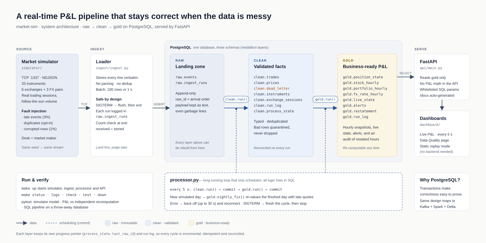
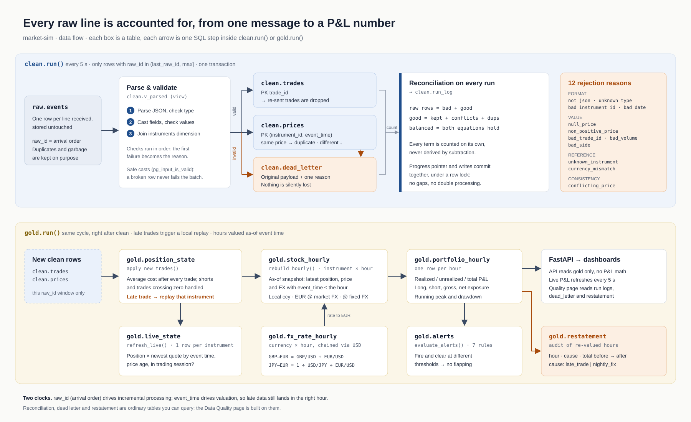

# market-sim: a real-time P&L pipeline that stays correct when the data is messy

> **In one sentence:** an end-to-end streaming pipeline that turns a market feed into a trading desk's profit and loss. Data arrives late, duplicated, corrupted and in four currencies, and every number can still be reconciled, traced back to its source and recomputed.



## 1. The problem

A trading desk needs a P&L it can trust, in near real time. Real feeds don't cooperate:

| Problem | What it looks like here | What goes wrong if ignored |
|---|---|---|
| Late data | ~3% of messages carry an event time earlier than messages already received | Positions and costs computed in the wrong order; past hours valued wrong |
| Duplicates | The same trade delivered twice | Doubled positions, inflated P&L |
| Bad rows | Not JSON, null or negative price, zero volume, unknown instrument, bad side | The pipeline crashes or, worse, bad values reach the report silently |
| Multi-currency | EUR, USD, GBP, JPY; no direct GBP or JPY rate to EUR | Inconsistent totals; can't tell stock P&L from FX P&L |

The source is a **deterministic simulator** I built: 33 instruments (30 equities on 6 exchanges, plus 3 FX pairs), real trading sessions and follow-the-sun activity. The trades are a **market-making desk's** own fills. The desk earns the spread, has a position limit per stock, and faces 10% informed client flow that moves the price against it (adverse selection), so the P&L curve means something. By default about 3% of messages are late and 1% are corrupted, and duplicates can be switched on. The same seed always gives the same stream, so every bug is reproducible.

## 2. Architecture

A **medallion architecture (raw → clean → gold)** in three schemas of one PostgreSQL database:

1. **Ingest** (`ingest/ingest.py`) reads the NDJSON stream over TCP and writes every line **verbatim** to `raw.events`. It does no parsing and no dedup, and writes in batches of 100 rows or 1 second. On SIGTERM it flushes before exiting, then checks *lines received = rows stored*.
2. **Raw** is append-only. `raw_id` is the arrival order, and `payload` is kept as text, garbage included. **Every layer above can be rebuilt from here.**
3. **Clean** (`clean.run()`) parses, validates and deduplicates. Valid rows go to `clean.trades` / `clean.prices`; invalid rows go to `clean.dead_letter` with a reason. Every run is reconciled.
4. **Gold** (`gold.run()`) computes positions and average cost trade by trade, then builds hourly valuation snapshots, portfolio exposure and drawdown, live state and alerts, plus an audit trail of every restated number.
5. **Orchestration** (`pipeline/processor.py`) is a long-running loop. Every 5 s it runs `clean.run()` → commit → `gold.run()` → commit, and on each new simulated day it calls `gold.nightly_fix()` to revalue the day that just ended. It only schedules; **all business logic lives in SQL**.
6. **Serving.** A FastAPI app (`api/main.py`) reads gold only, does no P&L math and uses whitelisted SQL parameters. There are two dashboards: Live P&L, refreshed every 5 s, and Data Quality.

## 3. Data flow: from one raw line to a P&L number



### Clean: every row must land somewhere

- **Incremental window.** Each run processes only `raw_id` in `(last_raw_id, max]`. The progress row is locked `FOR UPDATE`, and the pointer and the writes commit in **one transaction**, so there are no gaps and no double processing.
- **Ordered checks.** Format first (JSON, type, ids, date), then values (price, volume, side), then references (known instrument, matching currency). **The first failing check is the reason**: one reason per row, 12 in total. Casts use `pg_input_is_valid`, so a broken row never fails the batch.
- **Dedup.** `clean.trades` is keyed on `trade_id`; `clean.prices` on `(instrument_id, event_time)`. A second quote with the same price is a duplicate and is dropped. A second quote with a different price is a conflict and goes to the dead letter (`conflicting_price`).
- **Reconciliation.** Every run writes a row to `clean.run_log`:
  ```
  raw rows = bad + good
  good     = kept + conflicts + duplicates
  ```
  Each term is **counted independently**, never derived by subtraction, so the equations are a real check.

### Gold: late data must land in the right hour

- **Positions and cost** (`gold.position_state`) use the average-cost method trade by trade. Shorts are supported, as are trades that cross zero: the old position is closed and the rest is opened at the trade price.
- **Late trade → local replay.** If a new trade is older than the latest one already processed for that instrument, that instrument's state is deleted from that point and replayed in `(event_time, raw_id)` order. Only the affected instrument is replayed, not the whole table.
- **Hourly as-of snapshots** (`gold.stock_hourly`). Each hour takes the latest position, quote and FX rate with `event_time ≤ hour`. Every figure comes in three versions: local currency, EUR at the market rate of the time, and EUR at a fixed reference rate. The gap between the two EUR figures is the FX effect.
- **FX via USD** (`gold.fx_rate_hourly`): `GBP→EUR = GBP/USD ÷ EUR/USD`, `JPY→EUR = 1 ÷ USD/JPY ÷ EUR/USD`.
- **Portfolio** (`gold.portfolio_hourly`): realized, unrealized and total P&L; long, short, gross and net exposure; running peak and drawdown.
- **Live state and alerts.** `gold.live_state` holds one row per instrument. `gold.alerts` applies 7 rules with thresholds relative to gross exposure, and **separate fire and clear thresholds** stop alerts from flapping.
- **Restatement audit** (`gold.restatement`). Whenever recomputing an hour changes its total, the pipeline records the hour, the cause (`late_trade` / `nightly_fix`) and the before and after values.

> **Two clocks.** `raw_id` (arrival order) decides *what to process next*, and `event_time` decides *which hour it counts in*. Late data is therefore never processed twice and never valued in the wrong place.

## 4. Design principles and guarantees

| Principle | How |
|---|---|
| Land first, judge later | Raw stores everything; change a rule and rebuild a layer (`sql/03_backfill.sql`, `sql/06_backfill_gold.sql`) |
| Nothing is silently dropped | Bad rows go to the dead letter with their original payload and a reason |
| Idempotent and re-runnable | Progress pointers, primary-key dedup, `on conflict do nothing`; every SQL file can be re-run |
| Reconcile every step | Row counts in ingest, two-level equations in clean, a run log in gold |
| History may change, but visibly | Late replays and the nightly fix write to `gold.restatement` |
| Compute once, serve read-only | The API only reads gold |

## 5. How I know it's right

- **Simulator tests** (`tests/test_market.py`) cover schema, determinism, sessions and weekends, the late/duplicate/bad switches, price sanity, volatility calibration and the intraday activity curve. They also check that the market maker earns the spread, respects its position limit, and loses to informed flow.
- **Independent P&L check** (`tests/test_pnl.py`). Average cost is checked against hand-worked numbers. Total P&L is also recomputed from raw messages as *cash flow + position × latest price*, which does not depend on any cost method.
- **SQL integration test** (`tests/test_pipeline_sql.py`) runs raw → clean → gold on a throw-away database. The feed includes a garbled line, a negative price and a duplicate trade, and the test asserts that 10 raw rows reconcile as 2 bad and 1 duplicate with `balanced = true`. It then sends a trade that is 20 minutes late and asserts that it triggers one replay, restates the 11:00 P&L from 100 to 200, and writes that change to `gold.restatement`.
- **Observability.** The Data Quality dashboard shows the rejection rate, rejection reasons, the late-data distribution and restated hours.

## 6. Trade-offs and the path to scale

**Why PostgreSQL rather than Kafka + Spark?** At single-node volume, transactions make "nothing lost, nothing doubled, everything balances" easy to prove, and `make up` starts the whole system. The design maps one-to-one onto a streaming stack:

| Here | At production scale |
|---|---|
| Simulator TCP stream | Kafka / Event Hubs topic |
| `raw.events` | Bronze Delta table |
| `process_state.last_raw_id` | Structured Streaming checkpoint / Kafka offsets |
| Dedup and dead letter in `clean.run()` | `dropDuplicates` + quarantine table |
| Late-trade local replay | Watermark + per-instrument `MERGE` |
| `processor.py` | Airflow / Databricks Workflows |

**Known limits.** Single node; no daylight-saving model. `nightly_fix` only goes back one day, so data more than a day late needs a manual backfill. Per-instrument replay and the full-table window for drawdown are the first things to optimise as volume grows.
